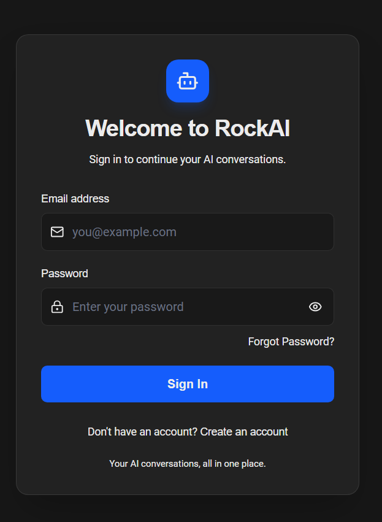
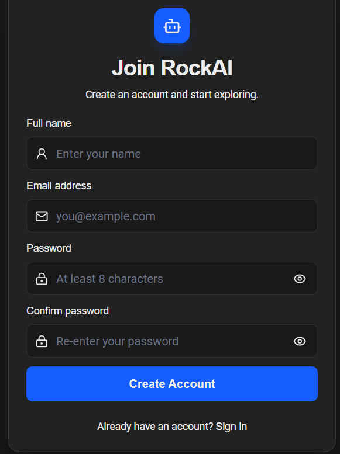
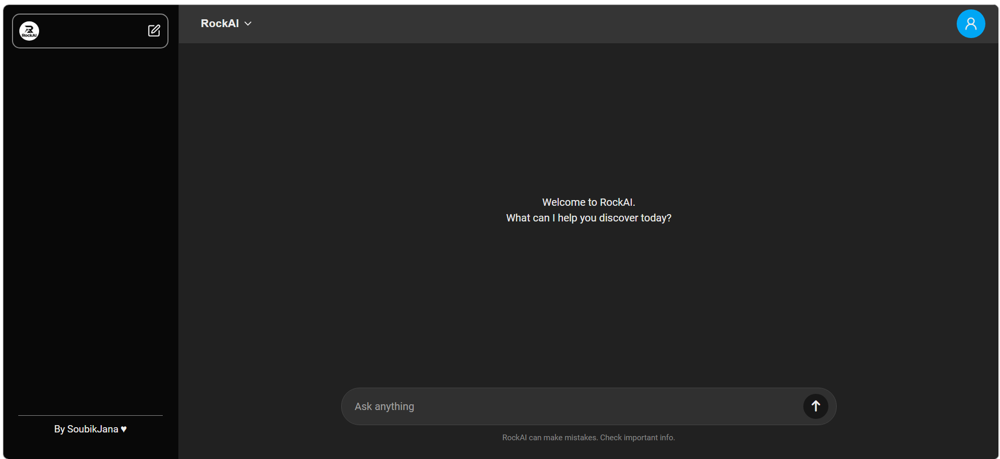
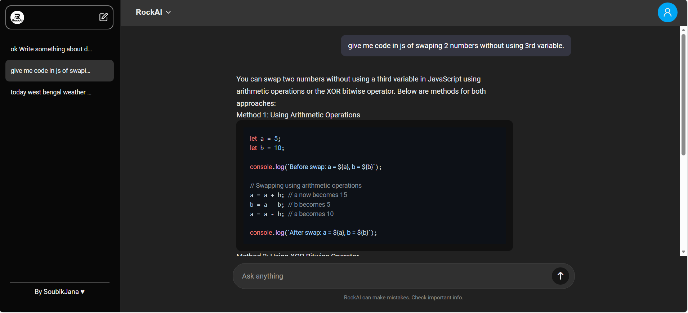
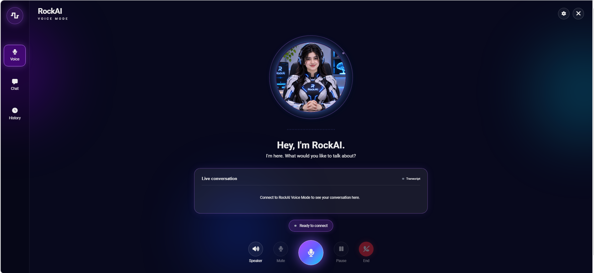
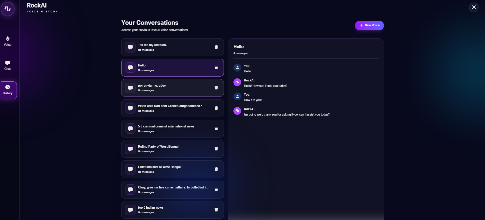

# 🤖 RockAI – AI-Powered Chatbot & Voice Assistant

RockAI is a full-stack AI-powered chatbot and voice assistant built using the MERN stack. It combines OpenAI-powered text conversations with Google Gemini Live for real-time voice interactions.

RockAI provides an interactive AI experience with user authentication, persistent chat history, voice conversations, location services, weather updates, and latest news integration.

## ✨ Features

### 1. AI-Powered Chat
- AI-powered text conversations using OpenAI API.
- Interactive conversational interface.
- Create and manage multiple conversations.
- Persistent chat history using MongoDB.
- Delete conversations.
- Thread-based conversation management.

### 2. Gemini Live Voice Mode
- Real-time voice conversations powered by Google Gemini Live API.
- Speech input and AI-generated audio responses.
- Live conversation transcription.
- Voice conversation history.
- Microphone selection and switching.
- Speaker output selection.
- Mute and unmute controls.
- Dedicated Voice Mode interface.

### 3. Smart Location Services
- Retrieves the user's current location using browser geolocation.
- Reverse geocoding to identify the approximate city and region.
- Provides location information through voice interaction.
- Uses OpenStreetMap Nominatim for reverse geocoding.

### 4. Real-Time Weather Information
- Retrieves current weather based on the user's location.
- Provides weather information for a specific city.
- Weather information through Voice Mode.
- Powered by Open-Meteo API.

### 5. Latest News Updates
- Retrieves the latest news based on requested topics.
- Supports topic-based news searches.
- Provides news updates through Gemini Live function calling.
- Integrated with NewsAPI.

### 6. Intelligent Function Calling
RockAI can interact with external services through Gemini Live function calling.

Available functions:

- `get_current_location`
- `get_current_weather`
- `get_weather_by_city`
- `get_latest_news`

These functions allow RockAI to retrieve external information instead of relying only on the AI model's existing knowledge.

### 7. User Authentication & Profile
- User registration and login.
- JWT-based authentication.
- Protected backend routes.
- Personalized user profile.
- Forgot password and reset password functionality.
- Email integration using Brevo.

### 8. Modern User Interface
- Responsive chat interface.
- Dedicated Voice Mode interface.
- Sidebar navigation.
- User profile menu.
- Interactive audio controls.
- Conversation history management.

## 🛠️ Tech Stack

### Frontend
- React.js
- Vite
- JavaScript
- CSS
- React Router
- Lucide React

### Backend
- Node.js
- Express.js
- MongoDB
- Mongoose
- JWT Authentication

### AI & External Services
- OpenAI API – AI-powered text conversations.
- Google Gemini Live API – Real-time voice conversations.
- NewsAPI – Latest news updates.
- Open-Meteo API – Weather information.
- OpenStreetMap Nominatim – Location geocoding.
- Brevo Email API – Password recovery emails.

### Development Tools
- Git
- GitHub
- VS Code

## 📸 Application Screenshots

### 1. Sign In Page


### 2. Registration Page


### 3. Home Page


### 4. AI Chat Interface & Sidebar


## 5. Voice Assistent Interface


## 6. Chat History 


## 📁 Project Structure

```text
RockAI/
├── Backend/
│   ├── config/
│   ├── controllers/
│   ├── Middlewares/
│   ├── Models/
│   ├── routes/
│   ├── Services/
│   ├── utils/
│   ├── server.js
│   └── package.json
│
├── Frontend/
│   ├── public/
│   ├── src/
│   ├── package.json
│   └── vite.config.js
│
└── README.md
```

## ⚙️ Installation and Setup

### 1. Clone the Repository

```bash
git clone https://github.com/Soubik-dev554/RockAI.git

cd RockAI
```

### 2. Backend Setup

```bash
cd Backend
npm install
```

Create a `.env` file inside the Backend folder.

Configure the following environment variables:

```env
OPENAI_API_KEY=
GEMINI_API_KEY=
MONGO_URI=
JWT_SECRET=

BREVO_API_KEY=
BREVO_SENDER_EMAIL=

NEWS_API_KEY=

FRONTEND_URL=
```

Add your own API keys and credentials.

### 3. Start the Backend

Run the development or start command defined in `Backend/package.json`.

### 4. Frontend Setup

Open another terminal:

```bash
cd Frontend
npm install
```

Create a `.env` file inside the Frontend folder:

```env
VITE_API_URL=http://localhost:8080/api
```

Update the URL if your backend uses a different port.

### 5. Start the Frontend

```bash
npm run dev
```

Open the local URL displayed by Vite in your browser.

## 🔐 Security

- API keys and database credentials are stored in environment variables.
- Environment files containing secrets are excluded from Git.
- Authentication is handled using JWT.
- Protected routes restrict access to authenticated users.
- API credentials are kept on the backend.

**Important:** Never upload actual API keys, database credentials, or `.env` files to GitHub.

## 👨‍💻 Developer

### Soubik Jana

GitHub: [https://github.com/Soubik-dev554](https://github.com/Soubik-dev554)

---

⭐ If you find this project interesting, consider giving it a star!
